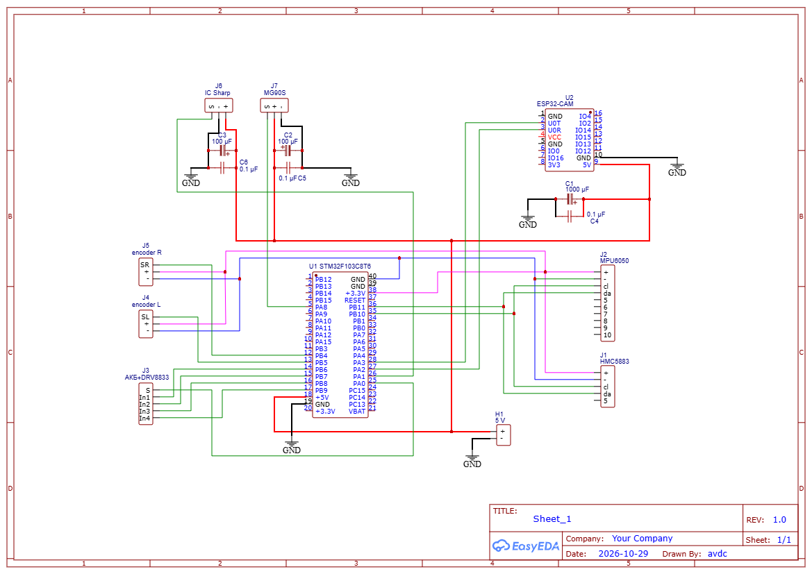
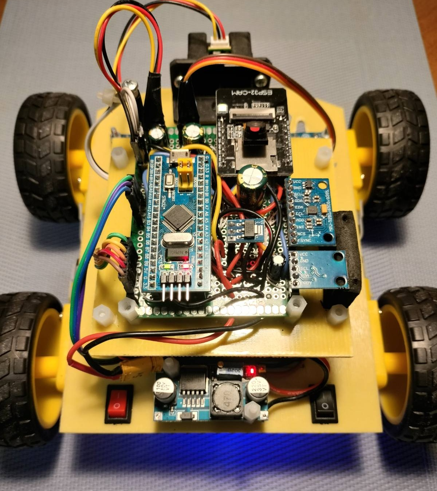
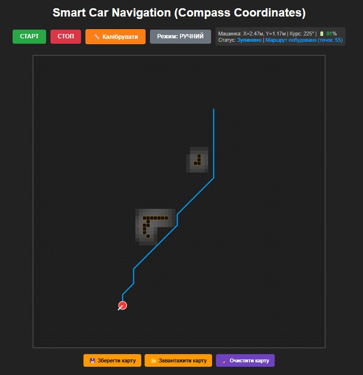
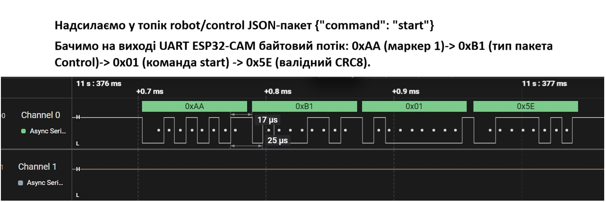

# STM32F1-smartUGV-RPi5-Astar

Автономна наземна робототехнічна платформа (Smart UGV) із розподіленою архітектурою керування, сенсорною навігацією, динамічним об'їздом перешкод та плануванням маршруту за алгоритмом **A\*** на зовнішньому сервері.

> **Статус проєкту:** Розробку завершено, проведено повний цикл стендових та ходових випробувань. Підтверджено автономне проходження маршрутів із динамічним виявленням перешкод, панорамним скануванням, перерахунком траєкторії сервером A\* та точним прибуттям у цільову точку.

---

## Архітектура системи

Система побудована за принципом розподілу обчислювальних задач між рівнем реального часу (MCU) та високорівневим сервером планування (SBC):

1. **Нижній рівень — Контролер реального часу (`STM32F103C8T6`, 72 MHz):**
   * Неблокуюче опитування сенсорів, обчислення диференціальної одометрії та злиття даних (Sensor Fusion із фіксацією курсу в стані спокою — ZUPT).
   * Диференціальне керування шасі (плавний розгін/гальмування, компенсація мертвої зони ШІМ, зона уповільнення перед точкою, контроль інерційного вибігу та П-регулятор утримання курсу).
   * Управління сервоприводом сканера та виявлення перешкод у вузькому й панорамному секторах.
2. **Транспортний міст (`ESP32-CAM`):**
   * Асинхронний парсер бінарних пакетів із контролем цілісності (`CRC8 Dallas/Maxim`) по UART (115200 бод).
   * Двосторонній шлюз **UART ↔ Wi-Fi / MQTT** для обміну телеметрією, картами перешкод та маршрутами.
3. **Верхній рівень — Навігаційний сервер (`Raspberry Pi 5`):**
   * Вебінтерфейс візуалізації карти, позиції робота та телеметрії в реальному часі.
   * Побудова локальної карти зайнятості (Costmap) за даними сканування та динамічний перерахунок маршруту алгоритмом **A\***.

---

## Апаратна частина (Hardware)

* **Мікроконтролер:** STM32F103C8T6 (Blue Pill).
* **Живлення:** LiPo 2S (7.4–8.4 В). Силові та логічні контури розділені за топологією **«зірка»** для усунення впливу імпульсних завад двигунів на I2C та АЦП.
* **Приводи шасі:** 4 мотор-редуктори постійного струму через двоканальний драйвер **DRV8833** + енкодери обертів на лівому та правому бортах.
* **Сенсори орієнтації:** 6-осьовий IMU **MPU6050** (гіроскоп) + 3-осьовий магнітометр **HP5883** на шині I2C2.
* **Система технічного зору:** ІЧ-далекомір **Sharp GP2Y0A02YK0F** (діапазон 200–1500 мм), встановлений на сервоприводі **MG90S** (сектор огляду ±90°).
* **Зв'зок:** Модуль ESP32-CAM.

### Розподіл периферії STM32F103
* **`TIM1` (CH1, PA8):** ШІМ сервоприводу MG90S (50 Гц, дискретність 1 мкс).
* **`TIM2`:** Внутрішній мікросекундний лічильник для точного обчислення кроку інтегрування `dt` гіроскопа.
* **`TIM3` (CH1/CH2, PB4/PB5, Partial Remap):** Апаратне захоплення імпульсів (Input Capture Interrupt) для диференціальної одометрії з урахуванням напрямку обертання.
* **`TIM4` (CH1–CH4, PB6–PB9):** 4-канальний ШІМ (10 кГц) керування драйвером двигунів DRV8833.
* **`ADC1` (PA0, PA1):** Послідовне опитування напруги акумулятора (через резистивний дільник із програмним ФНЧ) та аналогового сигналу Sharp IR.
* **`I2C2`:** Асинхронне опитування MPU6050 (`0x68`) та компаса HP5883 (`0x2C`).
* **`USART2` (PA2/PA3, 115200 бод):** Повнодуплексний бінарний обмін з ESP32-CAM.

### Принципова схема та зовнішній вигляд

---

## Особливості реалізації ПЗ (Firmware)

* **Модульна архітектура без RTOS (Superloop + State Machines):** Код розділено на незалежні модулі телеметрії (`telemetry_module`) та навігації/керування (`pilot_module`), побудовані на неблокуючих кінцевих автоматах.
* **Sensor Fusion & Калібрування:**
  * Інтегрування кутової швидкості MPU6050 (50 Гц) з корекцією дрейфу нуля за даними магнітометра (10 Гц) через комплементарний фільтр із коректною обробкою переходу через `0°/360°` та блокуванням дрейфу в стані спокою.
  * Вбудований режим автоматичного кругового калібрування компаса (Hard-Iron offset) зі збереженням калібрувальних коефіцієнтів у **Flash-пам'ять** STM32.
* **Надійний бінарний протокол (UART):**
  * Власний протокол із двобайтними маркерами кадру (`0xAA` для Downlink, `0xDE` для Uplink), автоматичним розрахунком розміру корисного навантаження через `sizeof()` та перевіркою цілісності **CRC8**.
  * Прийом команд та точок маршруту на STM32 реалізовано в апаратному перериванні `USART2_IRQHandler` на базі скінченного автомата.
* **Інтелектуальний сканер перешкод:**
  * Кусково-лінійна інтерполяція характеристики Sharp IR за експериментально знятою таблицею калібрування (точність < 5 мм).
  * Під час руху по прямому відрізку працює вузьке сканування (`±11°`), яке ігнорує перешкоди за межами поточного відрізка. При виявленні перешкоди робот виконує контрольовану зупинку (з фіксацією 60 мс спокою енкодерів після інерційного вибігу) та проводить 180-градусне панорамне сканування (31 точка).

---

## Верифікація та результати випробувань

Для налагодження протоколу обміну та таймінгів використовувався логічний аналізатор, що дозволило верифікувати бінарні кадри UART, роботу кінцевого автомата прийому та розрахунок CRC8 на фізичному рівні:

### Ключові показники за результатами ходових тестів:
* **Точність навігації та об'їзду:** під час автономного проходження маршруту з виявленням перешкоди, побудовою карти та об'їздом по 7 точках A\* фінальна похибка прибуття склала **~5 мм** (`x: 4.051, y: 5.655` при цільових координатах `4.05, 5.65`).
* **Лінійна одометрія:** на дистанції 1000–2000 мм похибка вимірювання шляху становить ~0.65%; точність зупинки на прямому відрізку з урахуванням зони уповільнення (15 см) — **21–27 мм**.
* **Навігація по курсу:** похибка розвороту на кути 15°–100° не перевищує **1.5°**; нульовий дрейф у стані спокою (`stopped` / `arrived`).

---

## Структура репозиторію

* [`STM32F103-smartUGV/`](./STM32F103-smartUGV) — прошивка мікроконтролера STM32F103 (STM32CubeIDE, C, HAL + пряма робота з регістрами).
* [`ESP32-CAM-WIFI-MQTT/`](./ESP32-CAM-WIFI-MQTT) — прошивка шлюзу UART ↔ MQTT (Arduino/C++, ArduinoJson v7, PubSubClient).
* [`RPi5-server/`](./RPi5-server) — сервер навігації на Python (Flask, MQTT, алгоритм A*, візуалізація карти та емулятор робота).
* [`Images/`](./Images) — принципові електричні схеми, осцилограми логічного аналізатора, фотографії платформи та скріншоти інтерфейсу.